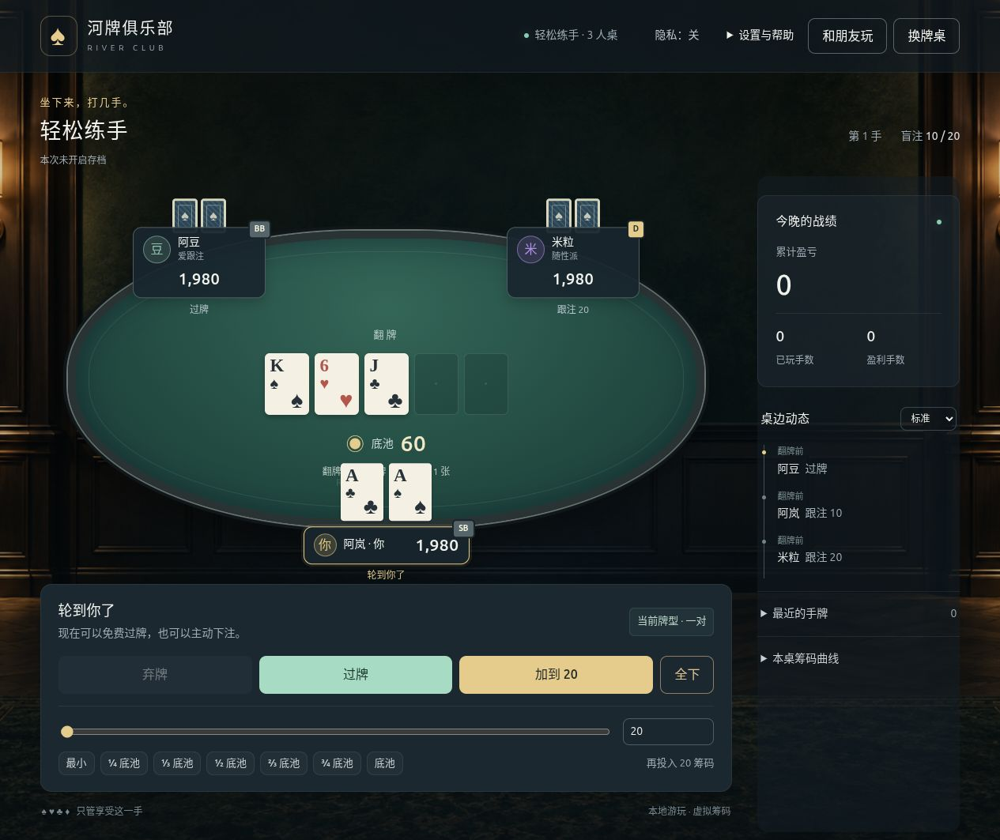
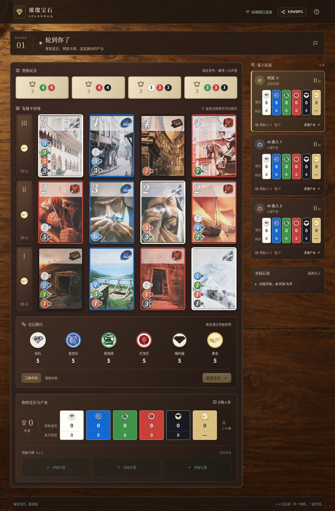

# LabGames · 局域网小游戏

和朋友连接同一网络，打开浏览器，一起开桌。

LabGames 收录四款中文网页桌游：德州扑克、璀璨宝石、七连翻和步步为营。每款游戏都支持与电脑对战，也能由一台电脑运行服务，让同一 Wi-Fi 或局域网内的朋友加入。玩家端只需浏览器，无需注册或安装客户端。

四个游戏统一使用 **Node.js + JavaScript/TypeScript + npm**。主机只需安装 Node.js 22.13+（推荐 24，自带 npm），不再需要 Python、Conda、pnpm 或独立数据库。

在仓库根目录执行：

```bash
npm install                 # 首次安装全部游戏依赖
npm start                   # 启动全部四个游戏
```

只开一个游戏也使用同一套命令：

```bash
npm start -- poker          # 德州扑克：http://localhost:8765
npm start -- splendor       # 璀璨宝石：http://localhost:3000
npm start -- flip7          # 七连翻：http://localhost:3007
npm start -- quoridor       # 步步为营：http://localhost:3009
```

切换游戏无需再安装环境。`Ctrl+C` 停止本次启动的服务；启动宝石时自动构建最新代码。Windows、macOS、Linux 使用相同的 npm 命令。

## 选一款游戏

| 游戏                  | 牌桌人数（含电脑） | 玩法                                       | 安装与启动                                  |
| --------------------- | ------------------ | ------------------------------------------ | ------------------------------------------- |
| ♠ 德州扑克           | 2～6 人            | 看牌、下注、读懂对手，在摊牌中赢下底池     | [扑克 README](games/poker/README.md)        |
| ◆ 璀璨宝石 · Splendor | 2～4 人            | 收集宝石、购买产业，以永久折扣积累声望     | [璀璨宝石 README](games/splendor/README.md) |
| 7 七连翻 · Flip 7     | 3～6 人            | 继续翻牌还是及时收手，在爆牌风险中争取高分 | [七连翻 README](games/flip7/README.md)      |
| ♟ 步步为营 · Quoridor | 2～4 人          | 移动棋子、放墙设防，率先抵达对岸获胜       | [步步为营 README](games/quoridor/README.md) |

人数不足时，可以添加电脑补位。四个游戏独立启动、独立保存进度，也可以同时运行。

## ♠ 德州扑克

一张使用虚拟筹码的无限注德州扑克牌桌。从翻牌前到河牌，选择过牌、跟注、加注或弃牌，与不同风格的电脑对手练习，也可以邀请朋友同桌。

- 浏览器支持 2～6 人，真人与电脑可混坐；提供八种电脑策略。
- 自动处理主池、边池和摊牌比较，支持逐手复盘与筹码曲线。
- 好友房支持邀请链接、二维码、入桌审批、暂时离席及座位找回。



[查看依赖与启动方法 →](games/poker/README.md) · [玩法与命令行进阶 →](games/poker/docs/GUIDE.md)

## ◆ 璀璨宝石 · Splendor

扮演宝石商人，从第一枚宝石开始建立自己的产业。拿取资源、预留发展卡、购买永久折扣，争取贵族青睐；有人达到 15 分后进入最终轮。

- 支持基础版 2～4 人桌，可由一位真人对战最多三位电脑。
- 90 张发展卡与 10 位贵族，自动校验支付、黄金使用和资源归还。
- 原版卡面、邀请链接与二维码，支持刷新续局和服务器重启恢复。



[查看依赖与启动方法 →](games/splendor/README.md)

## 7 七连翻 · Flip 7

翻到不同数字就继续累积分数，重复数字则爆牌。选择及时收手，或冲击七张不同数字的额外 15 分奖励，争夺 200 分终点。

- 支持单人对战电脑与 3～6 人局域网房间，每次联机行动限时 10 秒。
- 原版卡面、状态印章、洗牌动画与排行榜；七连翻庆祝等待全员鼓掌后收起。
- 全桌弹幕与可选记牌器；房主可在准备大厅调整设置，下一局无需重建房间。


[查看依赖与启动方法 →](games/flip7/README.md) · [联机功能说明 →](games/flip7/docs/MULTIPLAYER.md)

## ♟ 步步为营 · Quoridor

在九乘九的木质棋盘上，每回合选择向前一步，或放一面围墙改变路线。绕过对手的阻碍，率先到达对岸；围墙不能封死任何人的通路。

- 支持双人、三人、四人电脑对战与同屏对弈，也能建立局域网好友房。
- 围墙预览与确认、合法走子提示、跳子和侧跳、最短路线提示。
- 电脑对战可悔棋，本地刷新续局；联机支持座位恢复与服务器重启续局。


[查看玩法与启动方法 →](games/quoridor/README.md)

## 如何开始

只需主机安装一套运行环境，其他玩家通过浏览器加入。首次安装需要联网，游戏运行期间无需外部服务或 API Key。依赖版本统一锁定在根目录 `package-lock.json`；自动化或全新环境可用 `npm ci` 安装。

| 游戏     | 主机环境                     | 默认端口 | 默认访问范围                |
| -------- | ---------------------------- | -------- | --------------------------- |
| 德州扑克 | Node.js 22.13+ 与 npm | `8765` | 局域网 |
| 璀璨宝石 | 同上，共用安装 | `3000` | 局域网 |
| 七连翻 | 同上，共用安装 | `3007` | 局域网 |
| 步步为营 | 同上，共用安装 | `3009` | 局域网 |

联机时保持主机和服务运行，并分享主机的局域网地址。其他设备上的 `localhost` 指向它们自己，不能用来连接主机。

`HOST=127.0.0.1` 可限制为本机访问。统一启动支持 `POKER_PORT`、`SPLENDOR_PORT`、`FLIP7_PORT`、`QUORIDOR_PORT` 分别设置端口；单独启动也支持 `PORT`。存档仍保存在各游戏目录，详情见各自 README。

从旧版升级时，先停止旧服务，再在根目录执行 `npm install`。若旧的 `games/splendor/node_modules` 是由 pnpm 安装，先移走或删除该依赖目录（不含存档），再运行 npm。旧扑克存档会复制式导入到独立的 Node 版存档，原文件保留；详见[技术栈与迁移说明](docs/TECH_STACK.md)。

## 统一开发命令

```bash
npm run doctor              # 检查 Node 版本和依赖
npm run dev -- flip7        # 开发任意游戏，也可选 poker / splendor / quoridor / all
npm test                    # 四个游戏的测试
npm run check               # 完整测试、语法/类型检查和宝石构建
npm run build               # 构建需要编译的游戏
npm test --workspace games/poker  # 只检查一个游戏
```

四个游戏通过 npm workspaces 管理。玩法、页面主题和存档彼此独立；依赖安装、命令入口和运行环境统一。开发约定见[技术栈说明](docs/TECH_STACK.md)。

## 项目导航

```text
LabGames/
├── README.md                 # 游戏总览与截图
├── package.json              # 四个游戏的 npm 工作区与统一命令
├── package-lock.json         # 唯一依赖锁文件
├── scripts/labgames.mjs      # 统一启动、开发和环境检查
├── docs/
│   ├── screenshots/          # 实际游戏界面截图
│   └── REPOSITORY_HISTORY.md  # 仓库导入与迁移记录
└── games/
    ├── poker/README.md        # 德州扑克安装、启动与维护
    ├── splendor/README.md     # 璀璨宝石安装、启动与维护
    ├── flip7/README.md        # 七连翻安装、启动与维护
    └── quoridor/README.md     # 步步为营安装、启动与维护
```

新增游戏时，在 `games/` 下建立 Node.js 项目，加入根目录工作区和启动器，提供 `start`、`dev`、`test`、`check` 命令，再补充本页简介和截图。截图均取自本项目的实际演示对局，采集说明见 [截图目录](docs/screenshots/README.md)。

原项目的导入提交与迁移方式见 [仓库迁移记录](docs/REPOSITORY_HISTORY.md)。

## 素材说明

本项目中的 Splendor 与 Flip 7 为非官方实现，名称及原版美术归相应权利人所有。素材来源和使用方式见 [璀璨宝石素材说明](games/splendor/docs/ART_SOURCES.md) 与 [七连翻素材说明](games/flip7/docs/ART_SOURCES.md)。
