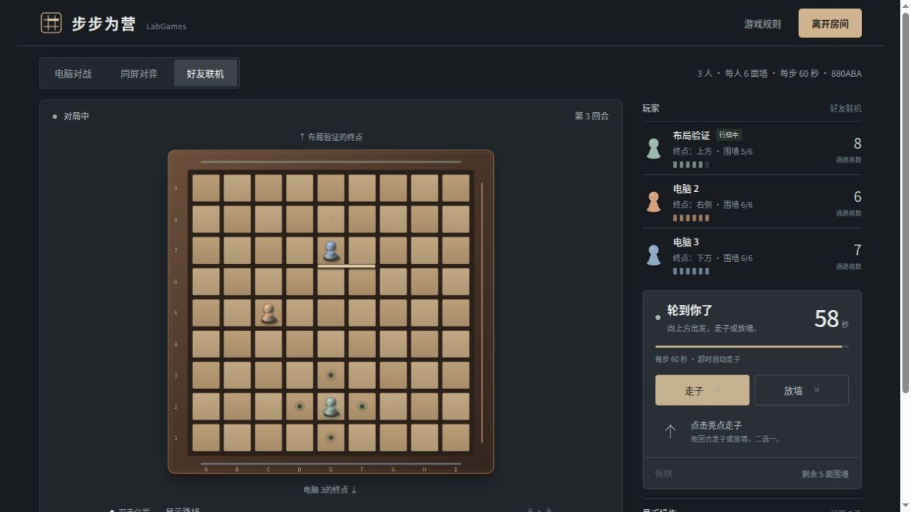

# 步步为营 · Quoridor

9×9 棋盘，支持 2～4 人。每回合移动棋子或放置围墙，先到达对岸获胜。

## 开始游戏

在仓库根目录安装统一依赖后启动：

```bash
npm install
npm start -- quoridor
```

打开 **http://localhost:3009**。游戏只需 Node.js 22.13+ 与浏览器，无额外依赖、账号或在线 API。也可以在本目录执行 `npm start`。

- **电脑对战**：默认双人，也可选择三人（两位电脑）或四人（三位电脑）博弈。提供标准和轻松两种难度，可悔棋，刷新自动续局。
- **同屏对弈**：两人、三人或四人共用一台设备，轮流操作；不提供悔棋。
- **好友联机**：同一 Wi-Fi / 局域网内创建双人、三人或四人房间，通过邀请链接或六位房间码加入。房主开始对局，空位自动补电脑；真人主动离开后由电脑接管，房主离开会转移房主。回合与规则均由服务器裁决。

朋友需要访问启动器显示的主机局域网地址，例如 `http://192.168.1.20:3009`，不能用自己设备的 `localhost`。保留主机服务运行。页面会从主机地址生成邀请链接；有多个网卡时，可直接分享浏览器中实际可达的局域网地址及 `?room=房间码`。

## 规则与操作

1. 双人各有 10 面围墙，三人各有 6 面，四人各有 5 面。底边棋手先手，多人按底、左、上、右顺时针轮流；三人使用底、左、上三侧，右侧空置。
2. 每回合移动棋子或放一面墙。普通走子上下左右一格，不能穿墙。先抵达自己正对面一排的任意一格获胜。
3. 两棋子相邻且中间无墙时可跳过一枚棋子；它身后有墙、边界或另一棋子时可侧跳。不能连续跨过两枚棋子。
4. 围墙占两格长度，可横放或竖放，不能重叠、交叉或完全切断任意棋手到终点的路径。放下后不能挪动。
5. 选“放置围墙”，点棋盘缝隙处选墙位，查看绿色/红色预览，再点“确认放墙”。手机操作相同。

快捷键：`M` 走子、`W` 放墙、`R` 旋转、`Esc` 取消墙位。棋盘合法落点及墙位可以用 Tab 与 Enter / 空格操作。“显示路线”和侧栏格数仅计算忽略棋子占位的最短通路，不预测跳子或对手未来行动。

三人角逐是本项目的扩展玩法：使用同一 9×9 棋盘，三位棋手各有 6 面墙（合计 18 面），各自前往正对岸；普通走子、跳子、侧跳和保留所有人通路的限制与其他模式一致。



双人、四人的规则参考 [Gigamic 官方规则书](https://export.gigamic.com/wp-content/uploads/2021/01/INS-RULES-QUORIDOR_10-2016.pdf)。为了便于本地对战，本实现固定底边棋手先手，非随机抽先。Quoridor 名称和玩法归相应权利人所有；本项目为非官方实现，木质棋盘与页面均使用原创 SVG / CSS，无外部图片或字体请求。

## 联机读秒

建房时可以选择不限时，或每步 10 / 20 / 30 / 60 / 120 秒，新房默认 30 秒。房主在准备室也能修改，全员都能看到规则；开局后固定，返回准备室后可以重设。

- 最后 5 秒突出显示倒计时。
- 超时由服务器自动选择一个合法、接近终点的走子，不放墙、不消耗围墙；操作记录标注“超时”。
- 刷新、重连或其他玩家离开不会延长当前回合；服务重启保留原截止时间。
- 截止后到达的操作会先结算超时，避免一次回合执行两个动作。
- 升级前已经存在的房间继续不限时，避免中途改变规则。返回准备室后，房主可选择读秒。
- 电脑对战和同屏模式保持不限时，读秒设置用于局域网房间。

## 保存与恢复

- 本地对局保存在当前浏览器的 localStorage，存储不可用时仍可游戏，但不能刷新恢复。
- 联机座位凭证保存在当前标签页 sessionStorage；刷新同一标签页可续局，丢失凭证后不能冒领已有座位。网络短暂中断会显示提示并自动重连。
- 联机房间、棋局及座位凭证保存在 `games/quoridor/data/rooms.json`，写入使用临时文件再替换。服务重启后可继续，24 小时未操作的房间过期。
- 关闭标签页视为暂时离线，保留座位并等待回来；主动点“离开房间”才由电脑接管。仅剩电脑时房间会删除。
- 房主可在胜利弹窗中返回准备室，原有真人座位保留，也可让新朋友加入。棋局结束后“开启新局”允许调整本地人数与难度。

## 开发与验证

```bash
npm run dev -- quoridor
npm test --workspace games/quoridor
npm run check --workspace games/quoridor
```

默认监听 `0.0.0.0:3009`。统一启动支持 `QUORIDOR_PORT`，单独启动支持 `PORT`；`HOST=127.0.0.1` 限制本机。`QUORIDOR_DATA_FILE` 可指定独立存档路径，适合测试或截图演示。

目录分层：`src/game.js` 规则与寻路、`src/bot.js` 电脑策略、`src/rooms.js` 房间裁决与保存、`server.mjs` HTTP 服务、`web/` 页面。前后端共用规则引擎，联机操作带版本号，重复或过期的操作不会重复落子。

自动化测试包含读秒权限、截止时间、超时与点击并发、重启恢复、旧房间兼容，以及双人、三人、四人配置和完整电脑对局，以及移动/跳子/侧跳、墙重叠与交叉、所有玩家通路、四个方向的胜利、完整电脑对局、房主权限、掉线凭证、并发操作、存档恢复、静态文件边界和统一启动。无需构建步骤。
